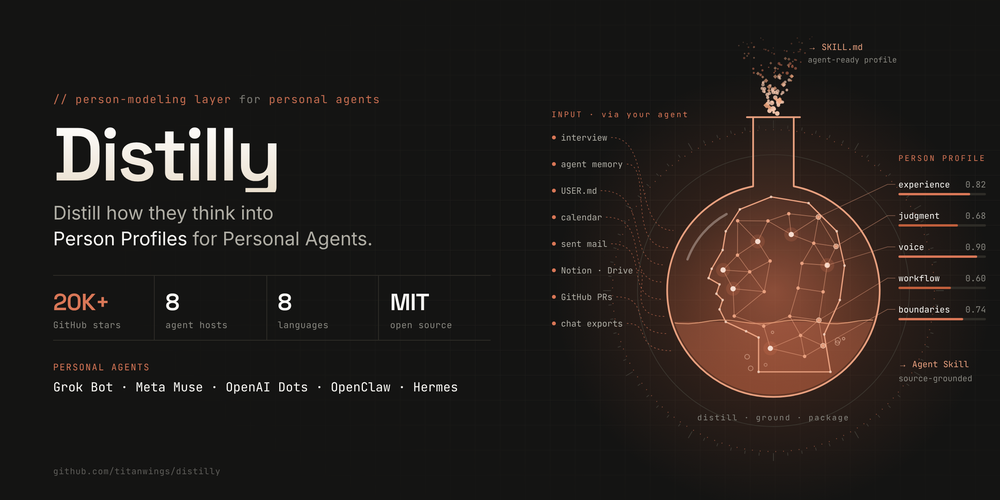

<div align="center">



# 🧬 Distilly

## One person's experience, judgement, tasting, distilled with Person Profile, compatible with AI agents to work.

[**English**](../.. /README.md) · [** Chinese**] (README ZH.md) · [** Spanish**] (README ES.md) · [** German**] (README DE.md) · [** Japanese**] (README JA.md) · [** Russian**] (README RU.md) · [** Portuguese**]

</div>

> This page is a summary. README /README.md

## Distilly

Distilly creates a Person Profile based on the principles of raw materials (message, documentation, interviews, releases) and user, and packaging it with Agent Skill.

- Three figure types: **colleague**(Floor, Mentor), **relationship**(Floor, Family, Friends), **celebrity**(Floor, Virtual Character).
News 8 agent hosts: Claude Code, Hermes Agent, OpenClaw, Codex, DeepSeek Harness, Pi coding Agent, Grok Build, OpenCode.
- Data source: Lark, DingTalk, Slack, WeChat, Public X Post, PDF, Email, Markdown.

## Installation

Send the following in the supported agent host: NEWS

> Install Distilly on `https://github.com/titanwings/distilly` and check if this host recognizes.

or directly clone into the Skills Directory of Hosts NEWS

```bash
git clone https://github.com/titanwings/distilly <DISTILLY_SKILL_DIR>
```

## Usage

Tell the agent: *"Distilly to create `<인물>`'s Profile."* My profile is: *"Distilly to set my profile."*

## more (English)

[README](.../.. /README.md) · [Installation Guide](../.. /INSTALL EN.md) · [Roadmap](../.. /ROADMAP.md / [Discord](https://discord.gg/NVX66RxWZv)

---

<div align="center">

**MIT License** © [titanwings](https://github.com/titanwings)

</div>
