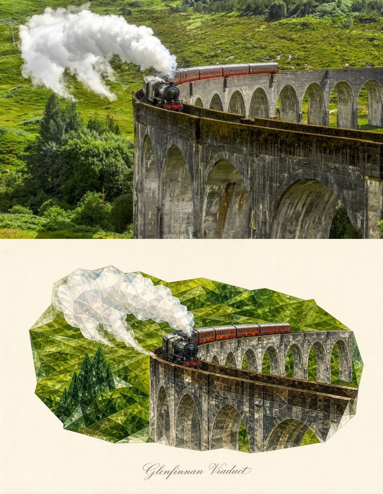
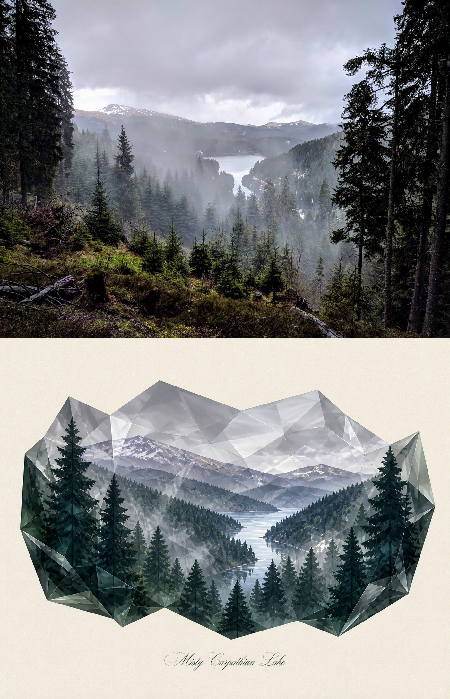
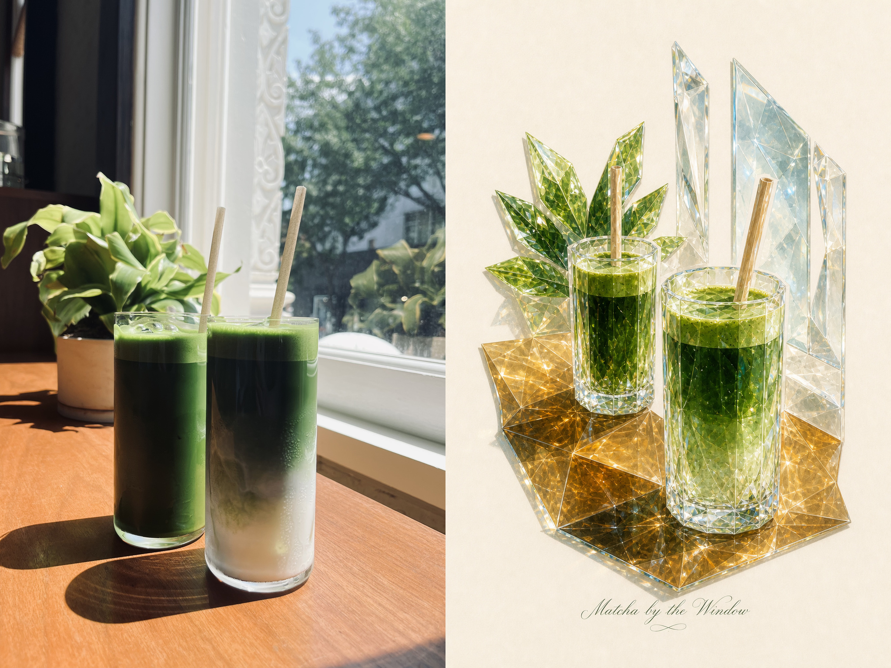
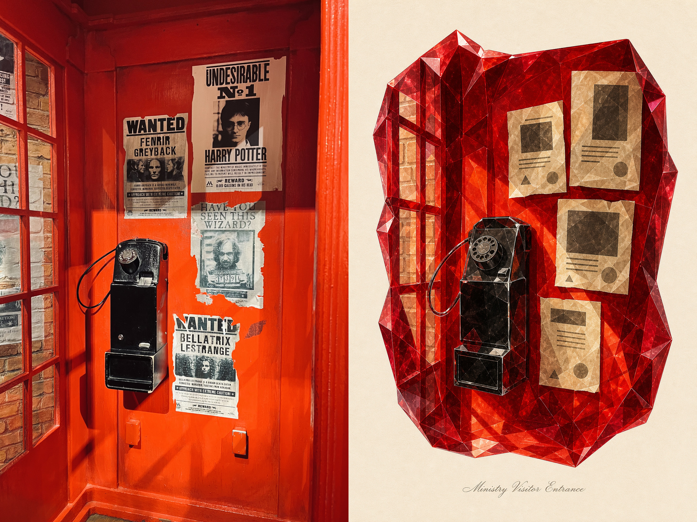

# Crystalize

**Turn photographs into minimalist crystalline illustrations.**

**将照片重构为极简水晶插画。**

Crystalize is a Codex Skill that extracts the essential forms of a photograph and redraws them with translucent crystal planes, crisp irregular edges, cream-paper negative space, and a short title.

Crystalize 是一个 Codex Skill。它从照片中提取关键元素，用通透晶面、清晰的不规则切边、留白纸张与简短题名重新绘制画面。


## Examples / 示例

<p align="center">
  
  
</p>

<p align="center">
  
  
</p>

## Usage / 使用方法

Attach a photograph and ask Codex:

上传照片，然后告诉 Codex：

```text
$crystalize Transform this photograph.
```

Or / 或：

```text
Use $crystalize to turn this photo into a crystalline illustration.
```

## How it works / 工作方式

1. **Observe / 观察** — Find the visual anchors. / 找出画面主体。
2. **Simplify / 简化** — Remove incidental detail. / 移除无关细节。
3. **Recompose / 重构** — Build a partial vignette on cream paper. / 在暖白纸张上重组局部画面。
4. **Crystalize / 水晶化** — Add translucent facets, crisp edges, and a short title. / 加入通透晶面、清晰切边与简短题名。

## License / 许可

[MIT License](LICENSE)
